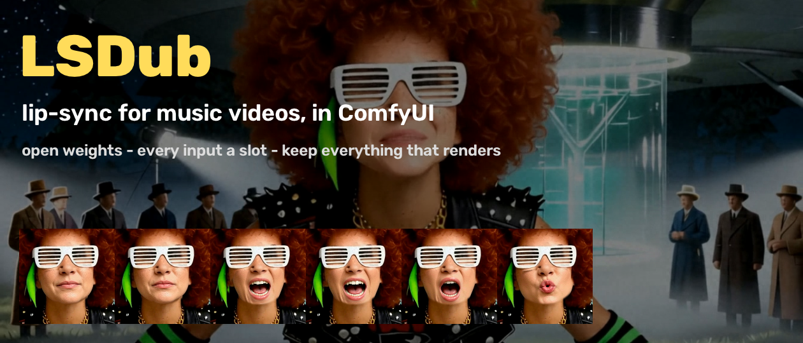

# LSDub for ComfyUI



**Lip-sync for music videos.** LSDub re-animates the singers' mouths in a finished video so they sing *your* song,
shot by shot, and tells you which shots worked.

Why: generated video gets you actors who look the part but don't actually sing the lines. Re-rendering the whole shot
throws away what was already good. So LSDub repaints only what it needs (the mouth) with what the shot already has
(the singer's own face). It respects the shot, then measures every shot instead of asking you to trust it.

## How it fits together

Three lanes feed one check.

```
VIDEO   clip or still  ->  Shot Split  ->  Cast  ->  Triage ----------+
                                                                     |
AUDIO   song + lyrics  ->  Vocal Split  ->  Lead Vocal  ->  Align ---+-->  MOUTH  ->  QA  ->  Save Cut
                                                                     |
MOUTH   Lip Kit + Mouth Tweaks  ->  Dub  ->  Occluders, Continuity --+
```

- **VIDEO** finds the cuts, names who sings in each shot, and labels every shot DUB, DUB-MEDIUM or NO, with the reason.
- **AUDIO** splits the vocal out and times every sung word.
- **MOUTH** builds a kit of the singer's 13 mouth shapes, then dubs the close-ups and mediums. The rest stays untouched.
- **QA** grades every shot, measures the sync, and hands you a fix-it list.

Every input is a slot. Bring a clip, a song, lyrics and a lip kit, or let the pack make them with open-weights models:
LTX-2.5 (video), Qwen-Image-Edit-2511 (stills and mouth shapes), ACE-Step 1.5 XL (songs).

## Start here

1. **Workflow 2** first. It runs on the CPU, about 10 to 15 minutes with the demo pack.
2. **Then workflow 3 on your own video.** It tells you what will dub before you spend anything.
3. **Workflows 1 and 4** need a big GPU (or a paid Comfy Cloud plan) and the generator models.

## Install

**Now (git):**
```
cd ComfyUI/custom_nodes
git clone https://github.com/HumanjavaEnterprises/comfyui-lsdub
<ComfyUI's python> -m pip install -r comfyui-lsdub/requirements.txt
```
Use the Python that runs ComfyUI (its venv, or `python_embeded/python.exe` in the Windows portable build).

**Once the pack is approved in the Comfy Registry:**
- ComfyUI Manager: search for **LSDub** and install it.
- comfy-cli: `comfy node install lsdub`

**You need:**
- ComfyUI 0.3.48 or newer (the first release with the V3 node API `comfy_api.v0_0_2`). Tested on 0.34.
- Python 3.10 or newer.
- `ffmpeg` on PATH.
- The packages in `requirements.txt`: numpy, OpenCV, SciPy, MediaPipe, Pillow, faster-whisper, SoundSwallower, g2p
  and transformers.

**Optional:**
- `pip install sam2 hydra-core iopath` for LSDub Occluders. Set `SAM2_BUILD_CUDA=0` to skip its CUDA extension.
- `pip install comfy-sdk` for the Comfy Cloud backend.

**Demo pack:** `python custom_nodes/comfyui-lsdub/scripts/fetch_demo.py`. It downloads about 29 MB, checks the
checksum, and installs into `ComfyUI/input/`. You get a 7.5 s clip, its song and dry lead vocal, the lyrics and their
transcript, a start still, a lip kit, and 15 s of "About That Time" (an ACE-Step song of ours) with its lyrics for
workflow 4. All original synthetic characters and original songs.

**Models:** every model, its size, licence, folder and which workflow needs it is in [MODELS.md](MODELS.md).
Short version: nothing downloads when ComfyUI starts. You place the generators; Whisper, DINOv2 and the face models
download on first use.

## The four workflows

They live in `example_workflows/` and show up in ComfyUI's template browser. Workflows 1 to 3 use `preset=landing`
(4 uses `none`), all with `backend=local`.

1. **Prompt Everything** (the hero). Still to video (LTX-2.5), tags and lyrics to song (ACE-Step), a lip kit built
   from the generated clip, then dub, QA and save. Needs a GPU and the generator models.
2. **BYO Clip and Song.** The demo clip, song, lead vocal, lyrics and lip kit, then triage, align, dub, verify, fix-it
   and save. It uses the bundled lip kit, so it runs on the CPU only (no GPU, no generator models). On the 7.5 s demo
   clip it dubs the one close-up in about 8 minutes; triage and align add a few minutes on the first run.
3. **Test and Learn.** Triage, alignment, sync QA with its review card, and the fix-it notes. No dub. Run this first
   on any new video.
4. **Make Your Character Sing** (experimental). A song and a character image (lyrics optional): vocal split, lead
   vocal, alignment, an LTX-2.5 performance video as long as the song, a lip kit built from it, the dub, verify, and
   the saved video with the song. Needs a GPU, the generator models, and `MelBandRoformer_kim_vocals.ckpt`. Works
   best with worded lyrics: the Dub here sets `vocalisations` to `mouth`, so scat (da da, ooh) is sung like words.
   With `skip`, those passages keep LTX-2.5's own mouth motion and may fail Verify.

## The nodes

Every input and output has a tooltip. Categories: `LSDub` (Project), `LSDub/video`, `LSDub/audio`, `LSDub/mouth`
and `LSDub/qa`.

**Project**
- **LSDub Project:** the project folder for one cut.
  - `mode`: `run` or `test_learn`.
  - `fps` and `song_offset`: video time = song time + offset.
  - `preset`: `landing` is the demo cast; `none` lets any named character sing.
  - `seed` and `force_shots` (e.g. `21,23` redoes those shots once).
  - `backend`: `local` or `comfy_cloud`.

**VIDEO lane**
- **LSDub Video:** a finished clip or a still, or a still plus a prompt, animated with LTX-2.5.
- **LSDub Still:** an image, optionally edited by an instruction with Qwen-Image-Edit-2511.
- **LSDub Performance:** a character image and a song make a performance video as long as the song: LTX-2.5 shots of
  about 5 s on the song timeline, each from the character image with a new seed (or chained from the last frame).
- **LSDub Shot Split:** finds the cuts. Fades and flashes are not cuts.
- **LSDub Cast:** enrolls the singers from reference pictures, a refs folder or a saved cast file, and names the faces
  in every shot.
- **LSDub Triage:** labels every shot DUB, DUB-MEDIUM or NO, with the reason: face size, profile, mouth hidden, too
  short, or no singing.

**AUDIO lane**
- **LSDub Song:** a finished song (plus an optional dry lead vocal), or a song generated from tags and your lyrics with
  ACE-Step.
- **LSDub Lyrics:** the sung words.
- **LSDub Vocal Split:** vocals and instrumental (Mel-Band RoFormer).
- **LSDub Lead Vocal:** lead, backing, and a lead-activity curve.
- **LSDub Align:** times every word. Lyrics are optional; without them the transcript is used. It runs speech-to-text
  (prompted with your lyrics), reconciles the result with them, then force-aligns. It builds the viseme track with
  vocalisations (ooh, da da) marked to skip, and writes a lyric check.

**MOUTH lane**
- **LSDub Lip Kit:** the singer's 13 mouth shapes, the "mouth LoRA" every dub needs. Bring a kit folder, or build one
  from a close-up shot.
- **LSDub Mouth Tweaks:** lead, word_close, face_target, snap, auto, continuity, raw warp flags, and an optional
  jaw-curve CSV.
- **LSDub Dub:** dubs each DUB and DUB-MEDIUM shot.
  - The shot is cropped to a 512 px face and warped at 2x the frame rate. The lower face is pasted back and a measured
    sync gate is applied.
  - With `auto`, the full-frame warp also runs, and the version with better measured sync is kept.
  - A continuity repair runs afterwards.
  - `vocalisations`: `skip` keeps the video's own mouth on ooh / da da, `rest` closes it, `mouth` sings them.
  - Each shot is saved as it finishes, so the dub resumes. Failed shots are reported, and by default the cut keeps
    their original frames.
- **LSDub Occluders:** masks a microphone or hand in front of the mouth, so the next dub keeps it in front. Uses
  Florence-2 and SAM 2.1.
- **LSDub Continuity:** repairs chosen shots again with stricter settings.

**QA**
- **LSDub Verify:** a likely-success score per dubbed shot (PASS, REVIEW or FAIL), compared with the source.
- **LSDub Scorecard:** every shot of the cut scored 0 to 100, worst first.
- **LSDub Sync QA:** the measured mouth against the vocal (correlation and lag), with a review card that scrolls the
  vocal waveform past a playhead.
- **LSDub Fix It:** each problem, what to try, and the `force_shots` string to paste into the project.
- **LSDub Save Cut:** saves to `final/` with LSDub's invisible watermark.

## Test & Learn vs Run

Look before you spend. In `test_learn` mode the Dub node passes the source through untouched, so the QA nodes measure
your original video: triage, alignment, measured sync and a fix-it list, with no GPU time spent on the dub. That
analysis is cached and reused when you switch to `run`.

## Keep everything that renders

Each node saves its output in the project folder, keyed by its inputs. A re-run reuses everything unchanged. Change a
lyric or force one shot, and only that work is redone. Re-runs are cache hits.

## Comfy Cloud (opt-in, paid plan)

Local is the default, and the example workflows run local. Set the project's `backend` to `comfy_cloud` to run the GPU
generators on Comfy Cloud: the Song, Still and Video slots and Lip Kit building. They run there through the Comfy
Python SDK (`pip install comfy-sdk`).
- **Sign-in:** your comfy.org account, the same sign-in as ComfyUI's API nodes. If that isn't available, LSDub uses
  the `COMFY_API_KEY` environment variable. The key is never logged or saved.
- **What runs where:** the dub and QA always run locally.
- **Plan:** API-key runs need a **paid Comfy Cloud plan**. Free-tier accounts are refused, and LSDub says so in plain
  words.
- **Models:** Comfy Cloud has the same generator models. LSDub renames the one file whose name differs there (the
  Qwen-Image-Edit Lightning LoRA). Tested 2026-10-29: a Still edit in 54 s and a 2 s LTX-2.5 clip in 16 s.
- **Cost:** cloud runs use your Comfy credits.

## Runtimes

Measured on a 100 s internal test film (not the demo pack):
- Shot split: about 20 s.
- Triage: about 8 min on the CPU, about 3 min with a GPU (identity on the GPU).
- Align: about 1 min.
- The dub: **about 7 to 8 min per dubbed shot on the CPU**, with auto.
- Building a lip kit: about 8 min on a 24 GB card.
- LTX-2.5: about 35 s for a 2 s clip on a 96 GB card.
- ACE-Step: about 12 s for 15 s of song.

Re-runs are cache hits.

## Troubleshooting

- **The first Align run sits there.** It is downloading Whisper large-v3 (about 3 GB) with no progress bar in the UI.
  Let it finish once.
- **The demo download fails.** Get `lsdub-demo-0.1.0.zip` from the GitHub Releases page by hand and run
  `python scripts/fetch_demo.py --zip lsdub-demo-0.1.0.zip`.
- **Align warns about the lyrics.** If what is sung matches the lyrics poorly (below 0.5), it warns and places the
  lyrics on the voice. Below 0.2 it stops and asks you to check the lyrics: they probably belong to another song.
- **A shot failed to dub.** It is reported, and by default the cut keeps its original frames. Run workflow 3 on the
  video, read Fix It, and paste its `force_shots` string into the project to redo just those shots.
- **A mic or hand gets painted over.** Run LSDub Occluders on that shot, connect its masks to the Dub, and dub again.
- **Scat passages fail Verify in workflow 4.** Set the Dub's `vocalisations` to `mouth`, or use worded lyrics.
- **Out of GPU memory.** ComfyUI offloads to system RAM on smaller cards (slower), or switch `backend` to
  `comfy_cloud`. Sizes are in [MODELS.md](MODELS.md).
- **Comfy Cloud refuses the run.** API-key runs need a paid plan; free-tier accounts are refused.
- **Occluders won't install.** Set `SAM2_BUILD_CUDA=0` before `pip install sam2` to skip its CUDA extension.
- **Nodes don't show up.** Check ComfyUI is 0.3.48 or newer, `ffmpeg` is on PATH, and the requirements went into the
  Python that runs ComfyUI.

## Built on and learned from

- [ComfyUI V3 node API](https://docs.comfy.org/custom-nodes/v3_migration): the node schema, tooltips and extension
  entry point the pack is written in (GPL-3.0 host; the pack only imports its API).
- [Comfy Python SDK](https://github.com/Comfy-Org/comfy-python-sdk): the opt-in Comfy Cloud backend (MIT).
- [cookiecutter-comfy-extension](https://github.com/Comfy-Org/cookiecutter-comfy-extension): the pack layout, tests
  and CI shape (MIT).
- [LTX-2.5](https://github.com/Lightricks/LTX-Video): the Video slot generator (LTX-2.x Community License Agreement).
- [Qwen-Image-Edit-2511](https://huggingface.co/Qwen/Qwen-Image-Edit-2511): the Still slot and the lip-kit mouth
  shapes (Apache-2.0).
- [MediaPipe Face Landmarker](https://ai.google.dev/edge/mediapipe/solutions/vision/face_landmarker): the 478-point
  face mesh every mouth measurement runs on (Apache-2.0).
- [DINOv2](https://github.com/facebookresearch/dinov2): the identity embedding behind Cast and Triage (Apache-2.0).
- [Florence-2](https://huggingface.co/microsoft/Florence-2-large) and
  [SAM 2.1](https://github.com/facebookresearch/sam2): occluder grounding and video masks (MIT / Apache-2.0).
- [Whisper](https://github.com/openai/whisper) via [faster-whisper](https://github.com/SYSTRAN/faster-whisper): the
  speech-to-text stage of alignment (MIT).
- [YuNet](https://github.com/opencv/opencv_zoo/tree/main/models/face_detection_yunet): face detection at any scale
  (MIT).
- [ACE-Step 1.5](https://github.com/ace-step/ACE-Step-1.5): the Song slot generator; it also made the demo songs (MIT).
- [Mel-Band RoFormer](https://arxiv.org/abs/2310.01809) (Wang et al., 2023): the vocal split architecture,
  reimplemented from the paper. It loads the MIT-licensed
  [MelBandRoformer_kim_vocals.ckpt](https://huggingface.co/KimberleyJSN/melbandroformer) checkpoint.
- [SoundSwallower](https://github.com/dhdaines/soundswallower) + CMUdict, [g2p](https://github.com/roedoejet/g2p):
  phone-level forced alignment and pronunciations (BSD / MIT).

## Licence and responsible use

Apache-2.0. If you redistribute LSDub or a work derived from it:
- Keep `NOTICE`.
- Keep the copyright headers.
- State what you changed.

To cite LSDub, use `CITATION.cff`.

LSDub's output carries an invisible watermark and a metadata tag. Dub only people and characters you have the right
to use. The demo characters are synthetic.
